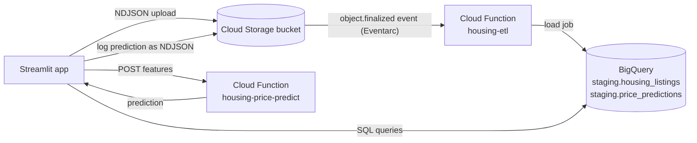

# California Housing ETL Pipeline on GCP

An event-driven pipeline that I built on Google Cloud: files dropped into Cloud Storage trigger a Cloud Function that loads them into BigQuery, a second Cloud Function serves house-price predictions, and a Streamlit app drives the whole flow end to end.

## Architecture



1. The app (or `gsutil cp`) uploads a newline-delimited JSON file to the bucket.
2. The `finalized` event triggers `housing-etl`. The function picks the destination table by filename prefix (`housing_listings_*` or `price_predictions_*`), creates the table from `schemas.yaml` if needed, and appends the rows.
3. The app polls BigQuery until the batch appears, then visualizes it.
4. Predictions from `housing-price-predict` are written back through the same pipeline into `staging.price_predictions`.

## Tech stack

- **Google Cloud:** Cloud Storage, Cloud Run functions (gen2, Python 3.11), Eventarc, BigQuery, Cloud Build, Artifact Registry
- **Python:** functions-framework, google-cloud-storage, google-cloud-bigquery, PyYAML
- **ML:** scikit-learn (HistGradientBoostingRegressor), joblib, NumPy, pandas
- **UI:** Streamlit
- **Data:** [California Housing](https://scikit-learn.org/stable/modules/generated/sklearn.datasets.fetch_california_housing.html), 20,640 census block groups from the 1990 census

## Streamlit app

| Tab | What it does |
|---|---|
| **Ingest** | Pick a random sample of the dataset, a generated sample batch, or upload a CSV. The app converts it to nested NDJSON, uploads `housing_listings_<batch_id>.json` to the bucket, and polls BigQuery until the Cloud Function has loaded every row. |
| **Explore** | Live BigQuery views: row and batch counts, average value by region, a map of listings, income vs. value scatter, and batch history. |
| **Predict** | Enter the eight features, call the ML function, and optionally log the prediction through the ETL pipeline into `staging.price_predictions`. Recent predictions are read back from BigQuery. |
| **SQL** | Run ad-hoc BigQuery SQL with a 1 GB billing cap. |
| **Bucket** | List recent files in the bucket and the table each one routes to. |

## Model

- **Algorithm:** `HistGradientBoostingRegressor` (300 iterations, learning rate 0.1)
- **Target:** median house value in USD
- **Hold-out performance (20% test split):** R² ≈ 0.85, MAE ≈ $29k
- **Artifact:** `ml_function/model.joblib` (~1 MB), bundled with the function so cold starts don't need to retrain

**Feature order** (send either a list in this order or an object with these keys):

| # | Feature | Description |
|---|---|---|
| 1 | `median_income` | Median household income, in units of $10,000 |
| 2 | `house_age` | Median house age, in years |
| 3 | `avg_rooms` | Average rooms per household |
| 4 | `avg_bedrooms` | Average bedrooms per household |
| 5 | `population` | Block group population |
| 6 | `avg_occupancy` | Average occupants per household |
| 7 | `latitude` | Latitude |
| 8 | `longitude` | Longitude |

## Project structure

```
.
├── etl_function/            # GCS-triggered Cloud Function (entry point: hello_gcs)
│   ├── main.py
│   ├── schemas.yaml         # BigQuery table schemas, routed by filename prefix
│   └── requirements.txt
├── ml_function/             # HTTP Cloud Function (entry point: predict)
│   ├── main.py
│   ├── model.joblib
│   └── requirements.txt
├── streamlit_app/
│   ├── app.py
│   ├── housing.py           # converts housing rows into nested NDJSON records
│   ├── requirements.txt
│   └── .streamlit/secrets.toml.example
├── scripts/
│   └── prepare_data_and_model.py   # downloads the dataset, writes samples, trains the model
├── data/                    # small NDJSON sample batches for testing
├── docs/
│   └── GCP_SETUP.md         # Cloud Shell and console walkthrough
├── deploy.sh                # one-shot GCP setup and deployment
└── LICENSE
```

## Quickstart

### 1. Local setup

```bash
python3 -m venv .venv
source .venv/bin/activate
pip install -r etl_function/requirements.txt -r ml_function/requirements.txt -r streamlit_app/requirements.txt

# Downloads California Housing, writes data/ samples, and retrains ml_function/model.joblib.
# On python.org builds of macOS Python, you may need:
#   export SSL_CERT_FILE=$(python -c "import certifi; print(certifi.where())")
python scripts/prepare_data_and_model.py
```

### 2. Deploy to GCP

Billing must be enabled on the project.

```bash
gcloud auth login
./deploy.sh <PROJECT_ID> us-central1
```

The script enables the required APIs, creates the bucket and the `staging` dataset (skipping either if it already exists), sets up IAM for the compute, Cloud Storage, and Eventarc service agents, deploys both functions, and writes `streamlit_app/.streamlit/secrets.toml`.

For a step-by-step Cloud Shell or console walkthrough, see [docs/GCP_SETUP.md](docs/GCP_SETUP.md).

### 3. Run the Streamlit app locally

```bash
gcloud auth application-default login
gcloud auth application-default set-quota-project <PROJECT_ID>

cd streamlit_app
# deploy.sh writes secrets.toml; otherwise copy the example and fill it in:
#   cp .streamlit/secrets.toml.example .streamlit/secrets.toml
streamlit run app.py
```

## Testing the pipeline

```bash
# Upload a sample batch; the filename prefix routes it to staging.housing_listings
gsutil cp data/housing_listings_batch_001.json gs://<PROJECT_ID>-housing-etl/

# Check the function logs for "Loaded 500 rows into staging.housing_listings"
gcloud functions logs read housing-etl --gen2 --region us-central1 --limit 20

# Query the loaded data
bq query --use_legacy_sql=false '
SELECT location.region, COUNT(*) AS listings, ROUND(AVG(median_house_value)) AS avg_value
FROM staging.housing_listings
GROUP BY 1 ORDER BY avg_value DESC'
```

Test the ML endpoint:

```bash
URL=$(gcloud functions describe housing-price-predict --gen2 --region us-central1 --format='value(serviceConfig.uri)')

curl -s "$URL"   # model version, feature list, and metrics

curl -s -X POST "$URL" -H 'Content-Type: application/json' \
  -d '{"features": [8.3252, 41, 6.98, 1.02, 322, 2.55, 37.88, -122.23]}'
# {"predicted_median_house_value": 418225.02, "model_version": "hgb-v1", ...}
```

## Troubleshooting

| Problem | Cause and fix |
|---|---|
| IAM grant to the Cloud Storage service agent fails on a new project | The agent may not be provisioned yet, so `gcloud storage service-agent` can't be relied on. `deploy.sh` builds the address as `service-<PROJECT_NUMBER>@gs-project-accounts.iam.gserviceaccount.com` and retries the `pubsub.publisher` grant. |
| ETL deploy fails with 403 `storage.buckets.get denied` | The Eventarc service agent is missing or its permissions haven't propagated. `deploy.sh` runs `gcloud beta services identity create --service=eventarc.googleapis.com`, grants `roles/eventarc.serviceAgent` to `service-<PROJECT_NUMBER>@gcp-sa-eventarc.iam.gserviceaccount.com`, and retries the deploy on this error. |
| Function build fails with a Cloud Build or Artifact Registry permission error | Newer projects don't give the default compute service account build permissions. Grant it `roles/cloudbuild.builds.builder`, `roles/logging.logWriter`, and `roles/artifactregistry.writer` (`deploy.sh` does this). |
| Re-running `deploy.sh` fails because the bucket or dataset exists | Fixed: both are checked first and skipped if present. |
| Explore tab shows `Syntax error: Unexpected keyword ROWS` | `rows` is a reserved word in BigQuery, so it must be backticked when used as an alias: ``AS `rows` ``. |
| File uploaded but no rows in BigQuery | The filename must start with `housing_listings` or `price_predictions`, and the `staging` dataset must exist. Check the function logs. |
| Streamlit shows a quota-project or permission warning locally | Run `gcloud auth application-default set-quota-project <PROJECT_ID>`. |
| ML URL returns 403 | The function isn't public. Allow unauthenticated invocations on the `housing-price-predict` Cloud Run service, or call it with an identity token. |

## Cleanup

`gcloud functions delete` takes one function name at a time:

```bash
gcloud functions delete housing-etl --gen2 --region us-central1 --quiet
gcloud functions delete housing-price-predict --gen2 --region us-central1 --quiet
gcloud storage rm -r gs://<PROJECT_ID>-housing-etl
bq rm -r -f <PROJECT_ID>:staging
```

If the project was created only for this lab, the simplest cleanup is to delete the whole project:

```bash
gcloud projects delete <PROJECT_ID>
```

## Acknowledgments

Based on the Cloud Functions ETL lab from [raminmohammadi/MLOps](https://github.com/raminmohammadi/MLOps/tree/main/Labs/GCP_Labs/CloudFunction_Labs/Lab1-CloudFunction_Setup). I adapted it to the California Housing dataset, fixed the original load-job configuration, replaced the Iris classifier with a regression model, and added the Streamlit app and deployment script.

## License

[MIT](LICENSE)
